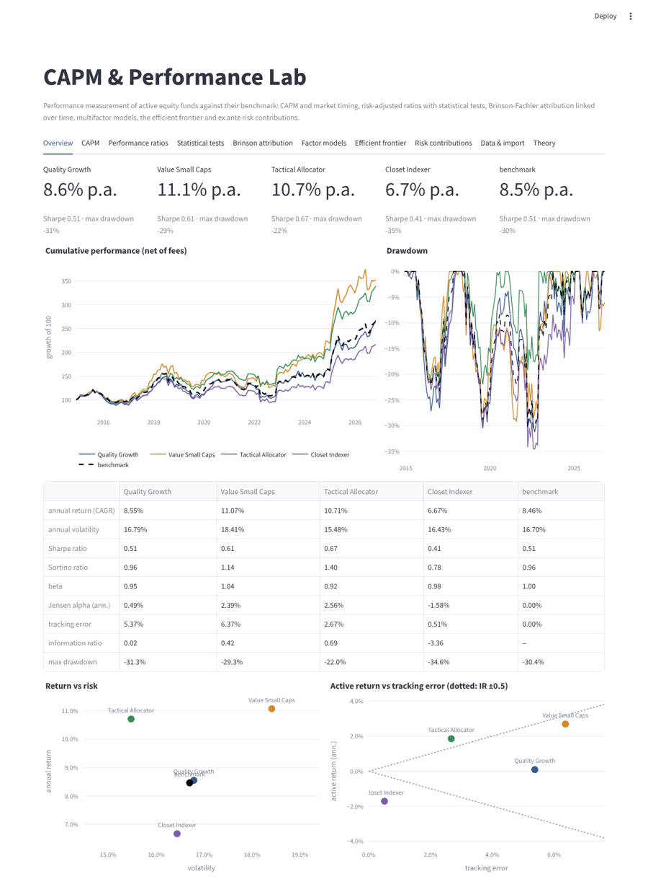
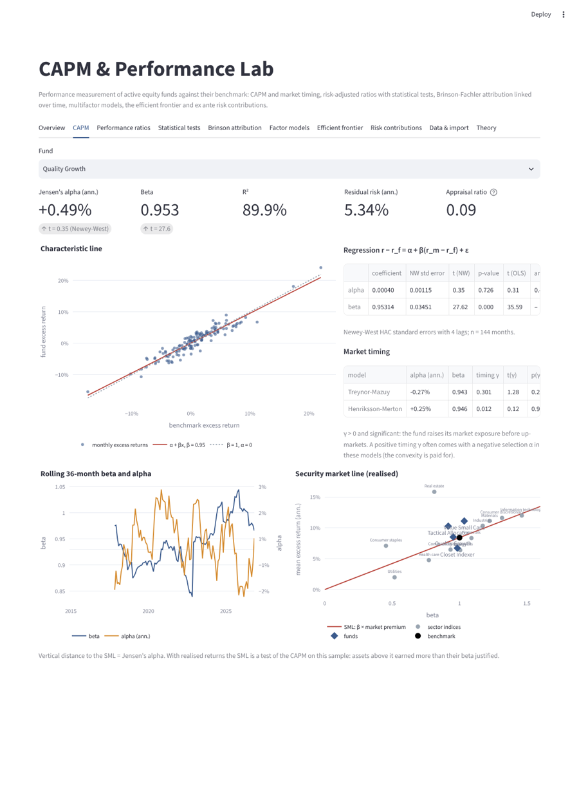
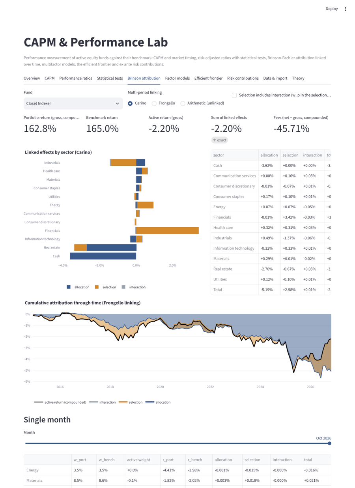
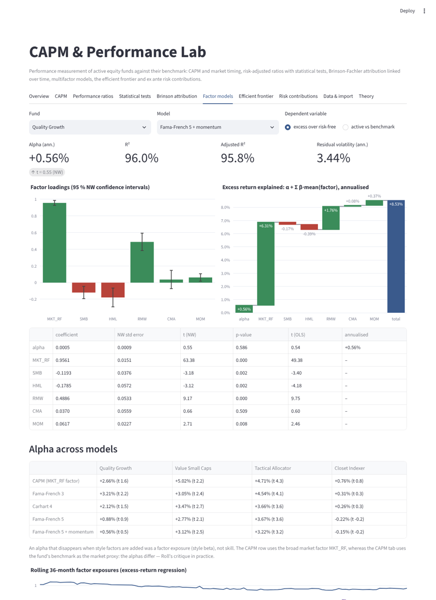
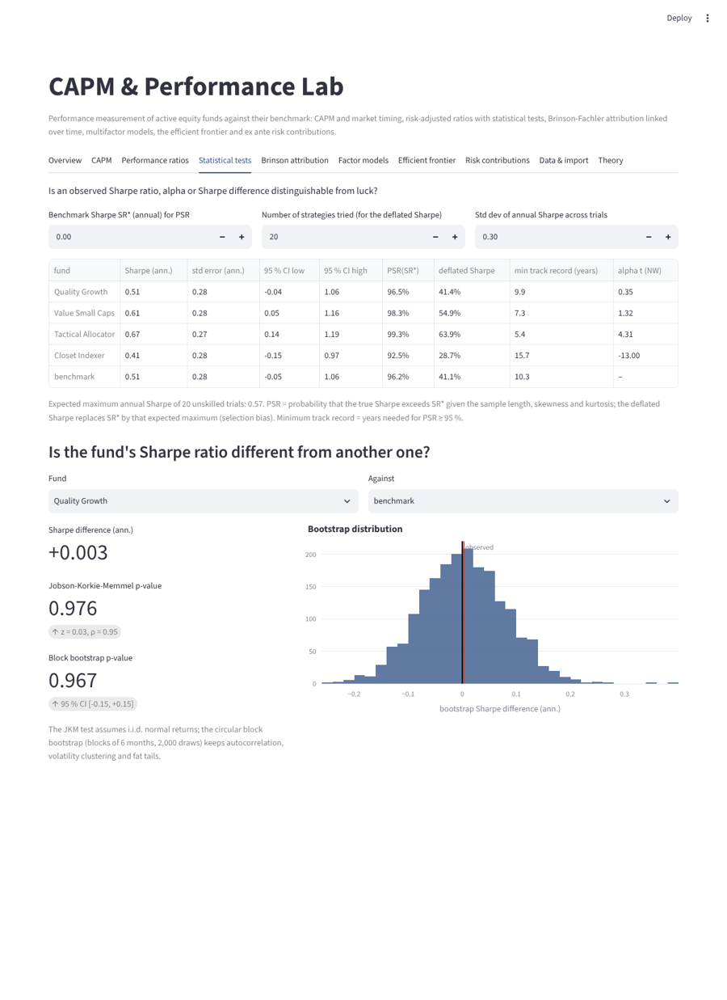
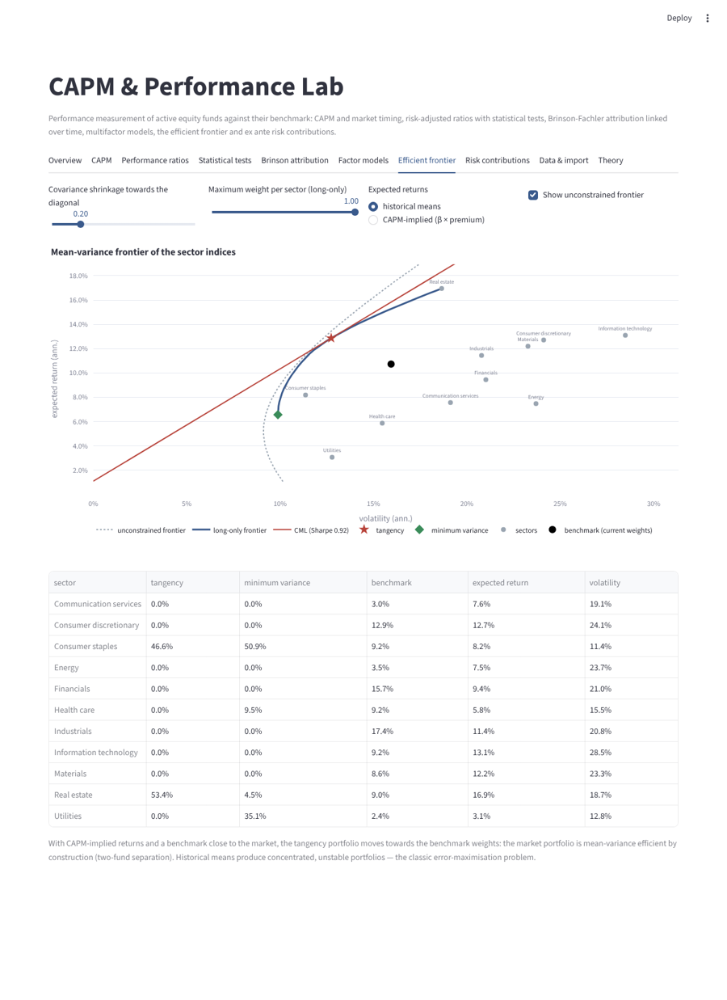
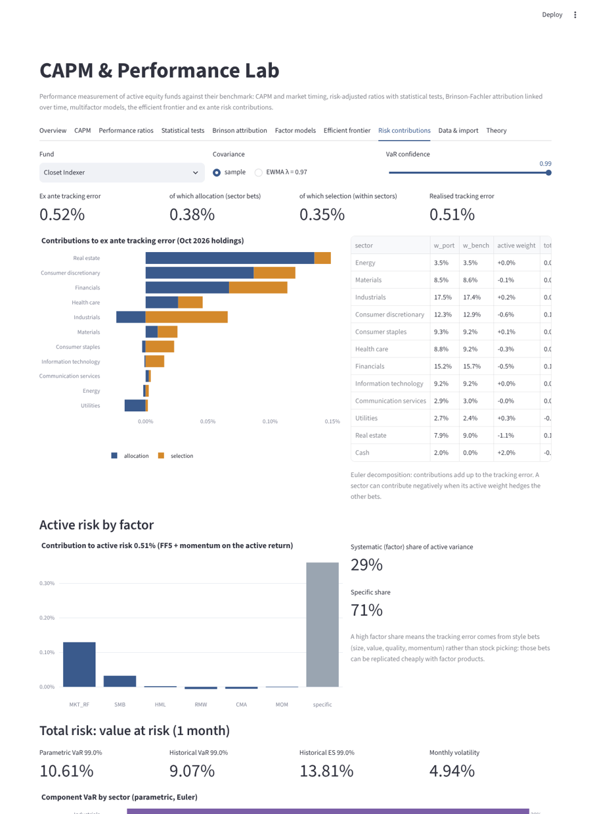

# CAPM & Performance Lab

A Python and Streamlit app that measures the performance of active equity funds against their benchmark. It covers the CAPM and market timing, risk-adjusted ratios with their statistical inference, Brinson-Fachler attribution linked over several periods, multifactor models (Fama-French, Carhart), the mean-variance frontier and ex ante risk contributions.

It runs on synthetic data by default. You can also import your own monthly return series and sector holdings as CSV files.



## What it does

| Tab | Content |
|---|---|
| **Overview** | Cumulative performance, drawdowns, key ratios, return/risk and active return/tracking-error maps |
| **CAPM** | Characteristic line and Jensen's alpha with Newey-West t-statistics, appraisal ratio, Treynor-Mazuy and Henriksson-Merton timing tests, rolling beta/alpha, realised security market line |
| **Performance ratios** | 20 measures, listed below; rolling ratios; return distribution with a Cornish-Fisher VaR; ranking consistency across measures |
| **Statistical tests** | Sharpe standard errors (non-normal returns), probabilistic and deflated Sharpe ratio, minimum track record, Jobson-Korkie-Memmel test, circular block bootstrap of the Sharpe difference |
| **Brinson attribution** | Brinson-Fachler allocation / selection / interaction by sector (optionally with interaction merged into selection), Carino or Frongello linking, cumulative attribution, single-month drill-down, fee gap |
| **Factor models** | CAPM, FF3, Carhart 4, FF5, FF5 + momentum on excess or active returns; loadings with confidence intervals; return decomposition α + Σβ·f̄; alpha across models; rolling exposures |
| **Efficient frontier** | Unconstrained and long-only frontiers of the sector indices, tangency portfolio and capital market line, minimum variance, covariance shrinkage, historical or CAPM-implied expected returns |
| **Risk contributions** | Ex ante tracking error split into allocation and selection by sector (Euler), active risk by factor (systematic vs specific), parametric/historical VaR and ES with component VaR |
| **Data & import** | CSV templates and upload |
| **Theory** | Derivation of the CAPM, multifactor models, the ratios and their limits, inference, Brinson linking, risk contributions, references |

The 20 measures on the **Performance ratios** tab are:

- annual return (CAGR) and annual volatility;
- excess return;
- Sharpe, Sortino and Treynor ratios;
- beta and Jensen's alpha;
- tracking error and information ratio;
- M²;
- max drawdown and Calmar ratio;
- Omega ratio;
- modified Sharpe ratio;
- up and down capture;
- skewness and excess kurtosis;
- hit ratio.

| | |
|---|---|
|  |  |
|  |  |
|  |  |

## Synthetic data

The generator produces 144 months (configurable) of data:

- **Risk-free rate**: rises from near zero to about 3.5 % a year.
- **Factor returns** (MKT_RF, SMB, HML, RMW, CMA, MOM):
  - drawn from a multivariate Student-t distribution (fat tails);
  - include a crisis episode;
  - have sample premia set to their design values.
- **Benchmark**: 11 sector indices driven by those factors, combined with drifting weights.

It also builds four funds, each with a planted characteristic that the tools should detect:

| Fund | Planted characteristic | What the tools find |
|---|---|---|
| Quality Growth | Sector tilts plus a quality/growth style (long RMW, short HML/SMB) and small stock selection | CAPM alpha that largely vanishes in FF5 (style beta, not skill) |
| Value Small Caps | Value/small-cap tilt plus genuine selection alpha | Alpha that survives all factor models |
| Tactical Allocator | Market timing through its cash weight | Significant Treynor-Mazuy / Henriksson-Merton γ |
| Closet Indexer | Tiny active bets, high fee | Negative alpha ≈ fee, information ratio ≈ −3 |

## CSV import

**Returns file** (required): one row per month with the columns `date, rf, benchmark, MKT_RF, [SMB, HML, RMW, CMA, MOM], <fund 1>, <fund 2>, …`.

- Values are monthly simple returns in decimals.
- The factor columns follow the Kenneth French data library convention.

**Sector file** (optional; used by attribution, frontier and risk contributions): columns `date, fund, sector, w_port, w_bench, r_port, r_bench`.

- Weights are beginning-of-month weights and must sum to 1 for each fund and date.
- Cash is a sector with `w_bench = 0`.

## Run

```bash
pip install -r requirements.txt
streamlit run app.py
```

Tests:

```bash
pip install -r requirements-dev.txt
pytest -q
```

The tests cover:

- recovery of alpha and beta;
- Newey-West with zero lags matching White standard errors;
- ratio values on a hand-computed example;
- detection of the planted skills;
- factor attribution adding up;
- exact single-period Brinson results;
- Carino and Frongello linking adding up exactly to the compounded active return;
- consistency between fund and sector data;
- Sharpe inference;
- frontier properties;
- additivity of the risk contributions;
- the CSV round-trip;
- an app smoke test.

## Project layout

```
perf/
  data.py          synthetic factors, sectors and funds; CSV validation
  metrics.py       performance ratios, drawdown, rolling measures
  regression.py    OLS with Newey-West errors, CAPM, market timing, factor models, SML
  inference.py     Sharpe standard error, PSR, deflated Sharpe, Jobson-Korkie-Memmel, block bootstrap
  attribution.py   Brinson-Fachler, Carino and Frongello linking
  portfolio.py     frontier, tangency/GMV, tracking-error, factor-risk and VaR contributions
  io.py            CSV templates and loading
app.py             Streamlit app
tests/             pytest suite
```

## Limits

- Returns are monthly and in a single currency. There is no currency attribution and no transaction-based (holdings-transaction) attribution.
- Attribution uses beginning-of-month weights, so intra-month trading appears in selection.
- The factor data are synthetic. For real use, plug in the Kenneth French factors matching the fund's region.
- Mean-variance estimates are sample-based. Shrinkage and CAPM-implied returns are provided to show how sensitive the frontier is to its inputs.

## Disclaimer

All data is synthetic. This is an educational and demonstration tool, not investment advice.

## License

MIT
